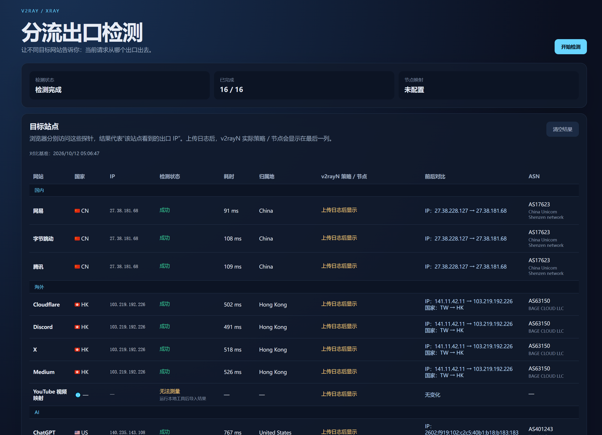

# RouteScope · 分流出口检测

### 看清每一次请求的出口，理解每一条分流策略。

面向 v2rayN / Xray 用户的轻量网络诊断面板。将站点出口检测、日志节点识别和切换前后对比集中在一个页面，让分流结果更直观、更容易核对。

[在线体验](https://ip.090803.xyz) · [下载 Releases](https://github.com/jeffak000/v2ray-split-checker/releases) · [反馈问题](https://github.com/jeffak000/v2ray-split-checker/issues)


## 界面预览



> 截图为演示时的检测结果，包含当时的出口 IP；不代表访问者自己的网络，也不代表固定可用性。

## 核心能力

| 功能 | 说明 |
| --- | --- |
| 多站点出口检测 | 覆盖国内、海外及 AI 相关服务，读取支持探针的目标站点返回的出口 IP |
| 地理与网络信息 | 显示国家旗帜、国家代码、归属地和 ASN 信息 |
| 独立检测状态 | 区分成功、超时、请求失败和无法测量，不把错误提示挤进 IP 列 |
| 请求耗时 | 显示出口探针请求耗时，不包含归属地查询时间；不是 ICMP Ping |
| 节点切换前后对比 | 对比上一轮与本轮 IP、国家、状态和日志节点的变化 |
| v2rayN 日志解析 | 支持粘贴日志或选择 `.txt` / `.log` 文件，在浏览器中解析 |
| 智能服务归类 | 将 `googlevideo.com`、`ytimg.com` 等归入 YouTube，识别 Gemini、ChatGPT 等服务的相关域名 |
| 最近节点识别 | 有时间戳时按时间选择最近节点；无时间戳时按日志出现顺序处理 |
| 节点名称清理 | 隐藏长数字组 ID 和连接方向前缀，保留可读策略 / 节点名称 |
| 本地结果保存 | 在当前浏览器的 localStorage 中保存最近完成的检测作为后续对比基准 |

## 直接使用

1. 打开 **[https://ip.090803.xyz](https://ip.090803.xyz)**，点击“开始检测”。
2. 查看 IP、国家、检测状态和耗时。首次完成的检测会成为下一轮对比基准。
3. 在 v2rayN 中切换节点或分流配置，再点击“开始检测”，查看“前后对比”。
4. 若要查看实际策略 / 节点，在 v2rayN 中打开日志，访问相关服务，让日志产生对应域名的连接记录。
5. 复制日志到页面文本框并点击“应用映射”，或用“选择日志”导入文件。
6. 切换节点后导入最新日志，再重新检测，可对比节点名称和出口变化。

**节点信息来自导入的日志，不能仅凭出口 IP 自动识别你的订阅组名。** 日志中没有的组名称或节点名称不会被推测补全。要判断当前情况，请使用最近产生的日志。

### 手动 IP 映射

也可以在文本框输入 JSON 数组并应用：

```json
[
  { "ip": "203.0.113.10", "group": "海外线路", "node": "新加坡示例节点" }
]
```

示例 IP 为文档保留地址，请替换为你的真实出口 IP。导入日志识别出的节点优先显示。

## 检测结果如何理解

- **成功**：目标探针返回了可读取的出口 IP；不代表登录、视频播放或 AI 对话功能一定可用。
- **无法测量**：目标未提供当前方法可读取的 IP，例如 YouTube、Gemini。可以通过日志核对节点。
- **请求失败**：可能是网络异常、站点拒绝请求或浏览器跨域限制，不能直接判定目标站点不可用。
- **超时**：探针未在设定时间内完成请求。
- **归属地查询失败**：出口 IP 已获取，但第三方信息查询未成功。

本项目不是完整的 AI 服务解锁检测器，也不能仅根据浏览器结果判断使用的是 V2Ray、Xray 还是其他代理内核。共享域名（例如泛用的 `googleapis.com`）不会强行归入某个服务。

## 本地运行与部署

从 Releases 下载 `routescope-v1.0.0.zip`，解压后打开 `index.html` 即可尝试使用。浏览器对 `file://` 的限制可能影响探针请求，建议用静态 HTTP 服务：

```bash
python -m http.server 8080
```

然后打开 `http://localhost:8080`。无需 npm 依赖或构建步骤。

可部署到 EdgeOne Makers / Pages、GitHub Pages 或其他静态托管平台。EdgeOne 直接上传网站目录即可；若通过 CLI 创建不含中国大陆加速区域的新项目，可使用：

```bash
edgeone makers deploy . -n your-project-name --area overseas --json
```

需要自行完成账号授权。自定义域名的 CNAME 目标应使用控制台提供的专用地址，并单独完成 HTTPS 配置。

## 数据与隐私

日志文件在浏览器内解析，本项目没有日志上传后端。对比结果（含出口 IP 和节点名称）保存在当前浏览器的 localStorage；在浏览器设置中清除该站点数据即可删除。

检测过程会向目标探针发送请求，并向 `api.090227.xyz/api/ipinfo` 提交已获取的出口 IP 以查询归属地与 ASN。第三方接口可能调整、不可用或有各自的数据处理规则。

请勿在公开 Issues 中粘贴完整代理配置、订阅链接、访问凭据或敏感日志。本仓库和 Release 不包含账号 API 密钥或真实 v2rayN 日志。

## 项目结构

```text
index.html       页面入口
script.js        基础探针与页面逻辑
patch.js         原有兼容补丁
features.js      状态、耗时、结果对比与日志归类
style.css       基础样式
extra.css       表格及扩展样式
layout.css      基础列宽配置
features.css    新版表格布局
docs/           项目截图
```

## 反馈与贡献

欢迎通过 Issues 提供可复现的问题，或提交 Pull Request 改善探针兼容性、服务域名归类和页面体验。反馈时请注明浏览器版本、代理模式、目标站点和脱敏后的错误信息。
